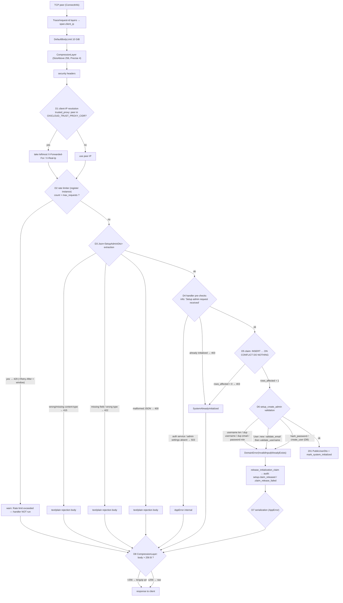

# Behavioral model — the actual execution path of `POST /api/setup`

This is the **predicted** model, reconstructed from the shipped version's own source
(`git show v0.10.0:src/main.rs`, `src/interfaces/middleware/*`, `src/interfaces/api/handlers/auth_handler.rs`,
`src/application/services/auth_application_service.rs`, `src/domain/entities/user.rs`). Each row carries an
evidence grade (see `experiment-matrix.md` §2); rows still at `source-only` are **not** confirmed behaviour and
must be upgraded by a measurement in `runtime-evidence.md` before anyone relies on them.



## Decision points, their observable markers, and which case exercises them

| # | Hop / decision | What the code does (source) | Observable marker | Case | Hypothesis | Grade |
|---|---|---|---|---|---|---|
| L1 | Trace + request-id | `ClientIpMakeSpan` + `SetRequestIdLayer` wrap every merged route; the id is echoed as `x-request-id` | header on the response; `ip=`/`request_id` fields on log lines | `rate-limit-6x` | — | `binary-observed` |
| L3/L8 | Compression policy | `CompressionLayer` gated by `SizeAbove::new(256)` + content-type exclusions, `CompressionLevel::Precise(4)` | `content-encoding` + transferred size differ only above 256 B | `setup-email-forbidden` (>256), `setup-pw7` (≤256) | **H11** | `binary-observed` |
| D1 | Client-IP resolution | `trusted_proxy::client_ip_from_parts`: when the peer is inside `OXICLOUD_TRUST_PROXY_CIDR`, the **leftmost** `X-Forwarded-For` entry wins (`X-Real-Ip` next), else the peer IP | which bucket gets exhausted; `ip=` field on the limiter warn line | `xff-honoured-trusted`, `xff-ignored-untrusted` | **H1** | `binary-observed` |
| D2 | Rate limiter | `get(ip).unwrap_or(0)+1` → `insert` (moka resets TTL on write) → `count > max` rejects; `retry_after()` returns the configured window | `429` + `Retry-After` + `Rate limit exceeded` warn; **no** handler log line, **no** SQL inside the case window | `rate-limit-6x`, `ttl-refresh`, `retry-after-constant`, `shared-budget`, `setup-get` | **H2, H3, H4, H5, H8** | `binary-observed` |
| D3 | `Json` extraction | axum's extractor rejects before the handler body runs | 415/422/400 with a **text/plain** body (the shape the SPA turns into a bare string throw) | `setup-json-*`, `setup-content-type-*` | **H4, H7** | `binary-observed` |
| D4 | Handler pre-checks | service presence (503), `is_system_initialized()` (403) | handler log line appears; body carries `error_type` | `terminal-201-then-403` | — | `binary-observed` |
| D5 | Initialization claim | `INSERT INTO auth.admin_settings … ON CONFLICT (key) DO NOTHING`; `rows_affected == 1` wins | one `INSERT` in the statement log; exactly one owner under concurrency | `concurrent-valid` | **H9** | `binary-observed` |
| D6 | Validation order | username length → duplicate username → duplicate email → `require_password_length` → `User::new` (email, then username) → hash → DB insert | which message/error_type comes back for a given input; claim released afterwards | `setup-pw7`, `setup-pw8-bademail`, `setup-email-nodot`, `setup-username-badchars` | **H6, H10** | `binary-observed` |
| D7 | Error serialization | `ErrorResponse { status, error, message, error_type }`, `error` == `message`; `error_type` = `ErrorKind::as_str()` at v0.10.0 (`"Invalid Input"`), `wire_name()` at HEAD (`"InvalidInput"`) | exact body bytes: `len = 68 + 2·len(message) + len(error_type)` | `setup-pw8-bademail` (candidate 219) | **H6, H12** | `binary-observed` |

## Observed overlay — the released binary (A, v0.10.0)

Every row above that was `source-only` is now resolved: the binary was run in the sandbox (identity proven by
sha256 against the production binary) and all eight questions answered from measurement. Raw numbers, verbatim
bodies and the per-case records live in `runtime-evidence.md` §A and `docs/re/evidence/A*.jsonl`.

| # | What the path actually does | How it was seen |
|---|---|---|
| D1 | `X-Forwarded-For` is used **only** when the peer is inside `OXICLOUD_TRUST_PROXY_CIDR`, and then the **leftmost hop verbatim** decides the bucket: `6.6.6.6, 10.0.0.5` → bucket `6.6.6.6`; an `XFF: 127.0.0.1` client shares the bare-peer bucket. Release posture logs `trusted proxy CIDRs: none`. | the exhausted bucket named from the limiter's own `ip=` log field (not from statuses) — §A.5 |
| D2 | A 429 is produced **before** the handler: no `Setup admin request received`, no SQL for that request (`app_sql_statement_count = 0`). Every request — accepted **or rejected** — re-arms the window: refused at +21.94 s when the original 15 s window had expired, refused at +27.23 s after a re-arm at +9.65 s, while an idle control expires normally (+17.33 s). | §A.1, §A.2 |
| D2 | `Retry-After` is the **configured constant**, not the remaining time: `3600` still at +22.01 s into a 3600 s window; `15` in the shortened posture. | §A.3 |
| D4 | No DPoP/CSRF gate on `/api/setup` (a request with no auth/DPoP/CSRF/cookies gets `201`); the order is limiter → method routing → extraction → handler, and a `GET /api/setup` that ends in `405` (zero-length body) **still spends one of the five slots**. | §A.7, §A.16 |
| D5/D6 | The claim row is **deleted**, so after a validation failure it is *absent* — not `updated_by = NULL`/`Uuid::nil()`. Measured sequence `SELECT` → `INSERT … ON CONFLICT DO NOTHING ($1 = '00000000-…')` → `DELETE`, row alive ≈ 4 ms, `si_rows = 0` afterwards; the audit line `setup.claim_released` is emitted. | §A.6 |
| D6 | Validation order confirmed by the branch that fired in each case: password length before the email check; the email/username branches carry the `Error creating admin user: ` prefix (`auth_application_service.rs:1391`). | §A.9–A.13 |
| D7 | Two serializers, not one: axum extractor rejections are **text/plain** with **no handler run and no SQL**, while domain failures use the compact envelope. Verbatim: | §A.8 |
| D8 | Compression threshold measured: bodies of 54/89/167/**219**/251 bytes arrive **raw** (identity-encoded), 259 → 151 and 317 → 167 under `Accept-Encoding: gzip`. The predicate tests the **decoded** length, so a *transferred* size ≤ 256 can still be a compressed larger body (259 → 151 proves it); the reproduced 219-byte response is raw because it was measured identity-encoded, **not** because 219 ≤ 256. | §A.22 |
| — | **Non-atomic by construction** (`get`+1 then `insert`, nothing serialising it); a hand-interleaved schedule of the split halves serves **2 on a budget of 1 at every opt-level** while the patched upsert answers `Ok(1)`+`Err(())` — a legal schedule of that computation, not a run of the production method under controlled interleaving. Only the burst detector's manifestation is stochastic (0/3–9/10; cause unisolated, load uncontrolled), and over HTTP it never appeared (1/64, spread ≈0.4 s). Latent leniency, not an observed bypass. | §A.4; `docs/re/patches/atomicity-guard-standalone-run.txt` |

```
| case                      | status | content-type              | bytes | sql | handler |
| setup-content-type-text   | 415    | text/plain; charset=utf-8 |  54   |  0  | no      |
| setup-content-type-absent | 415    | text/plain; charset=utf-8 |  54   |  0  | no      |
| setup-json-syntax-error   | 400    | text/plain; charset=utf-8 |  89   |  0  | no      |
| setup-json-missing-field  | 422    | text/plain; charset=utf-8 |  99   |  0  | no      |
| setup-json-wrong-type     | 422    | text/plain; charset=utf-8 | 134   |  0  | no      |
| setup-pw7                 | 400    | application/json          | 167   |  5  | yes     |
| setup-pw8-bademail        | 400    | application/json          | 219   |  5  | yes     |
```

The 219-byte body is verbatim `{"status":"400 Bad Request","error":"Error creating admin user: Validation
error: Invalid email: missing @","message":"…same…","error_type":"Invalid Input"}`, i.e. the
`error_type` token on this build is the **space form** `"Invalid Input"` (13 B) — which is exactly what makes
`68 + 2·69 + 13 = 219` possible, and what makes the same request 218 bytes at HEAD (`"InvalidInput"`, 12 B).

Read the text/plain rows as **fixture instances, not constants**: an extractor rejection embeds the offending
position (`line 1 column N`), the field name and the type, so its length follows the submitted payload. Only the
`application/json` rows are fixed message strings (for a given configuration), which is what makes the
domain-validation family enumerable at all.

Measured, and not obvious from the code shape: that text/plain family is **input-controlled and unbounded**, because
the rejection echoes the submitted JSON **key text** (`serde_path_to_error`'s path segment is the input key, and
`axum-core`'s message prints it — `SetupAdminDto` has no `deny_unknown_fields`, so an unknown key is ignored, its
value is parsed, and a syntax error inside it reflects the key). Measured max 4176 bytes from a 4096-byte key,
linear growth, capped only by the route's 10 GiB body limit; and an instance of **exactly 219 bytes** was
reproduced (`docs/re/evidence/extractor-length-bound.md`). Consequence for triage: a 400 body's *length* alone
never identifies its branch — the `Content-Type` does.

Two corrections to earlier statements in this file and in the first report: the effective posture is
`login 10/60 s, register 5/3600 s, refresh 20/60 s` (the login and refresh windows are 60 s, not an hour), and
the rollback leaves **no row** rather than a nil-marked one.

## Canonical failure chain (the operator's symptom, as a path)

1. The setup wizard is a `<form … novalidate>` whose submit handler gates only password length (from
   `/api/config`) and the confirm match — **the email is never validated client-side** (source-only; H7 covers
   the display half).
2. A malformed email reaches D6 and comes back as an `InvalidInput` 400 whose message is wrapped by
   `format!("Error creating admin user: {}", UserError)` — at v0.10.0 the only reachable 69-byte message is
   `"Error creating admin user: Validation error: Invalid email: missing @"`, giving
   `68 + 2·69 + 13 = 219` bytes (candidate, H6).
3. The wizard renders `err.data?.message`-style reads against a throw that carries the body **directly** (or, for
   a text/plain rejection, a bare string) ⇒ the operator sees `setup failed: unknown` instead of the message
   (H7; unit-verified, and the deployed `auth.ts` is byte-identical to the pre-fix file).
4. The operator retries ⇒ each attempt spends the **shared** register/setup budget (5 / 3600 s) at D2, and a
   rejected attempt re-inserts the key ⇒ the window keeps moving (H2, H5).
5. After five attempts inside the window the surface answers `429` for an hour of *silence* — and any further
   attempt extends it (H2, H3). `/api/auth/status` still reports `initialized:false` because the setup never
   succeeded.

## Where the observed overlay lives

- `runtime-evidence.md` §A — the released binary (A), both postures, per case.
- `runtime-evidence.md` §B/§C — the same corpus against B (v0.10.0 source build) and C (patched).
- `differential-results.md` — the A/B/C verdict table with code-path explanations.
- `patches/README.md` — what each patch changes and which hypothesis it closes.

Every row above whose grade is not yet `binary-observed` must be filled in from those sections before the final
report claims it; the final report copies the grade, never upgrades it silently.
